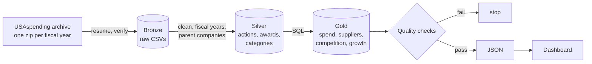

# Procurement Pulse

I wanted to see what a big government buyer's supply chain actually looks like from the inside: who it buys from, how much of it is competed, and where it would be stuck if one supplier had a bad year. The Department of Veterans Affairs publishes every contract action it signs, so I pulled seven years of them (FY2019–FY2025) and built a pipeline and dashboard around those questions.

Dashboard: https://sudhaseeli.github.io/procurement-pulse/

Data comes from the [USAspending.gov award data archive](https://www.usaspending.gov/download_center/award_data_archive) (Federal Procurement Data System contract records). Everything runs in Python and DuckDB. Nothing gets published unless 13 data-quality checks pass.

## What I found

That's 899,666 contract actions across 465,496 awards, $379B in total.

**Spending nearly tripled.** It went from $28.8B in FY2019 to $78.3B in FY2025. More than half of the increase (56%) is medical services, and social services adds another 19%.

**A handful of companies get most of the money.** Four suppliers received half of everything: McKesson (15.3%), UnitedHealth Group (15.1%), TriWest Healthcare Alliance (13.7%) and Optum Labs (9.0%). There are 24,826 suppliers in total, and just 148 of them account for 80% of the dollars.

**This was the part I found most interesting from a supply chain angle.** I looked at the 295 categories where VA spent at least $25M. In 47 of them, one company holds more than half the spend. Those 47 add up to $221B, 59% of all the money in those categories. McKesson supplies 98% of VA's $59B in drugs and biologicals. TriWest holds 100% of the $36B government health insurance category.

**Sole-sourcing went down, but so did real competition.** New-award dollars that weren't competed at all fell from 12% to 7%. But among competed dollars, the share where only one company bid rose from 30% to 48%. In medical services it's 78%. A contract can be competed on paper and still have no competition.

**Most contracts stay the size they were signed at.** I looked at 83,295 contracts and purchase orders of $100K or more. 6% grew by more than half, adding $37B, and 22% actually shrank. The biggest jumps were three UnitedHealth orders from FY2025 (+$3.0B, +$2.1B, +$1.8B) and an AT&T telecom order that grew 247%.

**September is wild.** It averages 25% of the year's spending, three times a normal month, because unspent money expires on 30 September. The last week of September alone had $75B of new awards, about a fifth of all new-award dollars. I expected that rushed money to be sole-sourced more often. It wasn't (6% vs. 10% the rest of the year), but it did draw a single bid more often (47% vs. 37%).

**Veteran-owned businesses are getting a smaller slice.** Their share dropped from 24.9% to 14.4%, even though VA has a Veterans First rule. In dollars they still went up, from $7.2B to $11.3B. The pie just grew much faster than their piece.

One caveat: these are reporting records, so they show what was signed and obligated, not what was delivered or paid.

## What tripped me up

- **The contract value column isn't a running total.** I first read `base_and_all_options_value` as the contract's current value. The quality check flagged 98,000 contracts with negative values. When I traced one contract by hand, each modification carried only the *change*: +$1,995, then +$997, then −$519. Now a contract's value is the sum of all its actions.
- **McKesson showed up twice in the supplier ranking.** The same parent company had reported under two different IDs over the years, so it was split into $40B and $18B. I switched to grouping by parent company name. Optum Labs still reports separately from UnitedHealth Group, though, and I left that as the data says rather than guessing.
- **USAspending's file server went down** for most of a day while I was building this. That's why the downloader resumes partial files and checks every zip before using it. A half-downloaded file or an error page never reaches the warehouse.

## How it works



A few decisions worth knowing about:

- I work at the level of **contract actions**, not awards. Every modification is its own row with a net amount, so money taken back shows up as a negative and nothing is counted twice.
- An award's starting point is its base action (modification `0`). Awards signed before FY2019 still count toward spending, but I leave them out of the competition and growth numbers, since I can't see how they started.
- Suppliers are **parent companies**, because if you're worried about depending on one supplier, it doesn't help that it has three subsidiaries.
- For the concentration numbers I use the HHI (sum of squared market shares, in percent). Above 1,800 counts as highly concentrated, and 10,000 means a single supplier.
- For contract growth I leave out indefinite-delivery vehicles, because their ceilings are upper limits, not real commitments.

Limits I'm aware of: the data is entered by contracting officers, so some codes are missing or wrong. A competed contract vehicle can still have orders that went to one company. And concentration here is within VA only, so a company that dominates VA may face real competition elsewhere in government.

## Data quality

The build stops and publishes nothing if a critical check fails. It checks that:

- every row is unique and has a date and a supplier
- all seven years are present
- the expected columns exist
- dollars reconcile from the raw files through to every table on the dashboard

There are also softer checks for things like missing category or competition codes. The latest run passed all 13, and the dollars match to the cent from 899,666 raw rows to the final tables.

## Running it

```bash
git clone https://github.com/sudhaseeli/procurement-pulse && cd procurement-pulse
python -m venv .venv && source .venv/bin/activate     # Windows: .venv\Scripts\activate
pip install -e ".[dev]"

pulse run                              # download, build, check, export
pulse build                            # rebuild from files already downloaded
python -m http.server -d docs 8000     # then open http://localhost:8000
```

The download is about 300 MB and the build takes under a minute. To poke around in the warehouse yourself:

```bash
duckdb data/warehouse.duckdb "SELECT * FROM gold.concentration WHERE top_share > 0.5 ORDER BY obligated DESC LIMIT 10"
```

Tests run offline against a small fake archive in the same format, with answers I worked out by hand. They cover:

- fiscal-year boundaries
- money taken back
- contract growth
- subsidiaries rolling up to their parent
- sole-source vs. single-bid awards
- the last week of September
- duplicate rows, missing columns and broken downloads

```bash
pytest -q
```

## Layout

```text
pulse/
  ingest.py      downloads
  transform.py   raw files to clean tables
  analysis.py    the analysis tables
  quality.py     data-quality checks
  export.py      JSON for the dashboard
  cli.py         pulse run | ingest | build
docs/            dashboard (GitHub Pages)
tests/
```

MIT license. Data from USAspending.gov (public domain).
